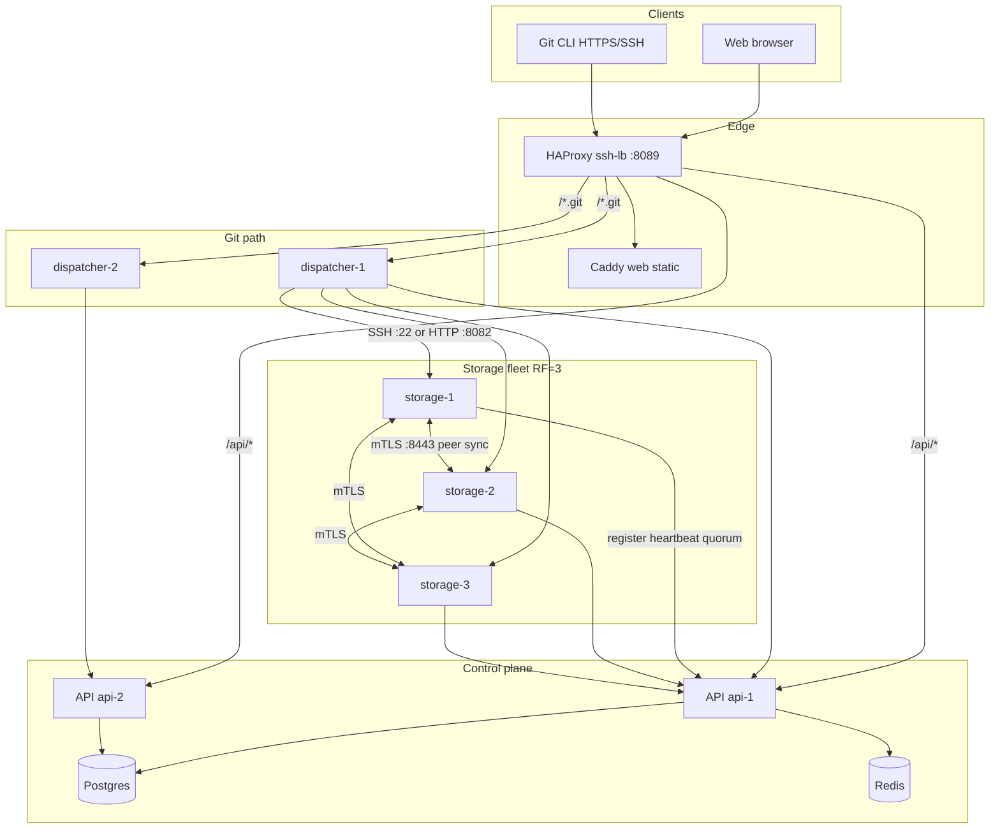
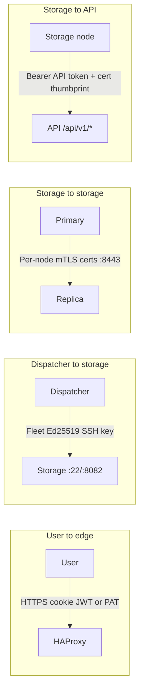
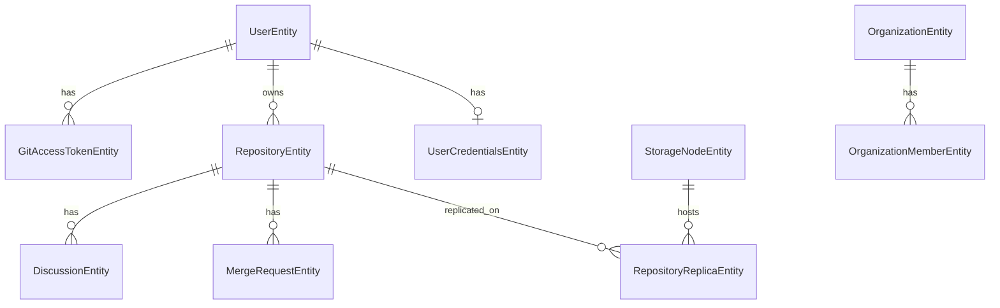

# OpenGitBase — Current State Overview

**Purpose:** Baseline for planning encryption improvements and distributed-system evolution.  
**Audience:** Agents and engineers entering the codebase cold.  
**Last updated:** 2026-10-18

For local setup and ports, see [README.md](../README.md). For feature-level design specs, see [prd/](prd/).

---

## 1. What This Project Is

OpenGitBase is a **self-hosted Git forge** (GitHub-like) in active development. It provides:

- Web UI for browsing repos, discussions, and merge requests
- Git over HTTPS (PAT) and optional SSH
- **RF=3 high-availability storage** (primary + 2 replicas, 2/3 write quorum)
- Organizations, repo membership, branch protection, push rules
- Admin fleet management for storage nodes

The project started from an **agentGenCli** .NET scaffold but has grown well beyond it: Nuxt web app, git dispatchers, and a 3-node storage fleet are all first-class components.

---

## 2. Runtime Topology

**Unified local entry:** `http://localhost:8089` ([docker-compose.yml](../docker-compose.yml))

| Component | Path | Role |
|-----------|------|------|
| API | [applications/OpenGitBase.Api/](../applications/OpenGitBase.Api/) | Control plane: auth, metadata, replication orchestration, content reads |
| Dispatcher | [applications/OpenGitBase.Dispatcher/](../applications/OpenGitBase.Dispatcher/) | Git Smart HTTP / SSH proxy; asks API for access + routing |
| Storage node | [applications/repo-storage-layer/](../applications/repo-storage-layer/) | Bare git repos, hooks, internal HTTP API, peer mTLS sync |
| Web UI | [applications/opengitbase-web/](../applications/opengitbase-web/) | Nuxt 4 SPA (cookie auth, hand-written API client); community pitch at `/pitch` |
| Shared .NET | [common/](../common/) | CQRS, EF Core, auth, encryption, DbContext |
| Features | [features/](../features/) | Vertical slices (Users, Repository, StorageNode, MergeRequest, etc.) |

---

## 3. What Is Implemented

### 3.1 Identity, auth, and access

| Area | Status | Key files |
|------|--------|-----------|
| User registration, login, email verify, password reset | Done | [features/users/](../features/users/), [Controllers/Authorization/](../applications/OpenGitBase.Api/Controllers/Authorization/) |
| OAuth (Google, Apple) | Done | [SignInController.cs](../applications/OpenGitBase.Api/Controllers/Authorization/SignInController.cs) |
| JWT in httpOnly cookies + Bearer | Done | [Startup.cs](../applications/OpenGitBase.Api/Startup.cs), [AuthCookieService.cs](../applications/OpenGitBase.Api/Services/AuthCookieService.cs) |
| Admin role (`role=admin` claim) | Done | Admin controllers |
| Personal access tokens (HTTPS git) | Done | [features/git-access-token/](../features/git-access-token/) |
| SSH public keys (git over SSH) | Done | [features/public-git-ssh-key/](../features/public-git-ssh-key/) |
| Repository-level authz (private repos) | Done | [RepositoryContentAuthorizationService.cs](../applications/OpenGitBase.Api/Services/RepositoryContentAuthorizationService.cs) |
| Org membership + invites | Done | [features/organization/](../features/organization/) |

### 3.2 Repositories and collaboration

| Area | Status | Notes |
|------|--------|-------|
| Repo CRUD with RF=3 provisioning | Done | Requires ≥3 healthy storage nodes |
| Repo members, settings, default branch | Done | |
| Protected branches + push rules | Done | Enforced at storage `pre-receive` hook |
| Web browsing (tree, blob, README, refs) | Done | Reads from storage via API; replica routing |
| Discussions (threaded, anchors, sub-threads) | Done | [features/discussion/](../features/discussion/) |
| Merge requests (backend) | Done | Full lifecycle API; E2E tested |
| Merge requests (frontend) | Partial | List/create/detail/review UI done; **approve/merge/publish/close not wired in UI client** |
| Commit change view | In progress | Backend + page exist; remediation issues open |
| Notifications | Done | In-app |

### 3.3 Distributed storage and replication

| Area | Status | Notes |
|------|--------|-------|
| 3-node storage fleet in compose | Done | `storage-1/2/3` in [docker-compose.yml](../docker-compose.yml) |
| Node enrollment + heartbeat | Done | Cert thumbprint + API token |
| Fleet dispatcher SSH key (Ed25519) | Done | Encrypted private key in DB; bootstrap token for dispatchers |
| Per-node PKI (mTLS) | Done | [docker/pki/](../docker/pki/) |
| RF=3 repo create (provision all 3) | Done | [CreateRepositoryWithStorageQueryHandler.cs](../applications/OpenGitBase.Api/Services/CreateRepositoryWithStorageQueryHandler.cs) |
| Write quorum 2/3 on push | Done | `post-receive` → API `quorum-replicate` (RF4: API builds the encrypted artifact itself, #413) |
| Peer sync over mTLS :8443 | Done | Separate from dispatcher SSH trust domain |
| Watermark-based durability | Done | Monotonic `PrimaryWatermark` + per-replica `AppliedWatermark` |
| Primary failover + epoch promotion | Done | [PromotePrimaryReplicaQueryHandler.cs](../applications/OpenGitBase.Api/Services/PromotePrimaryReplicaQueryHandler.cs) |
| Background: RF1→RF3 backfill, rebalance, anti-entropy | Done | [HaStorageBackgroundService.cs](../applications/OpenGitBase.Api/Services/HaStorageBackgroundService.cs) |
| Admin replication dashboard | Done | Web + API |
| Git HTTPS via HAProxy | Done | [git-https-personal-access-tokens.md](prd/git-https-personal-access-tokens.md) |
| Optional SSH git (`--profile ssh`) | Done | Port 2211 via HAProxy |
| Git LFS over HTTPS | Done; on in production since 2026-10-18 (100 MiB per object), off by default (`Lfs:Enabled`) | Batch API + `basic` transfer on the dispatcher; four-copy layout (plaintext on primary/read replica, encrypted on both encrypted replicas); verify = primary + ≥1 encrypted copy; pre-receive pointer gate; reconciler steps "LFS copies" and "LFS orphans"; [git-lfs-operations.md](deployment/git-lfs-operations.md) |

### 3.4 Testing and ops

- **1050+** backend tests, **66** frontend unit tests
- E2E regression framework + merge-request E2E script
- Rolling update: [scripts/rolling-update.sh](../scripts/rolling-update.sh)
- Fleet bootstrap: [scripts/bootstrap-fleet.sh](../scripts/bootstrap-fleet.sh)

---

## 4. How Components Interact

### 4.1 Trust domains (critical for encryption planning)

OpenGitBase uses **four separate trust paths** — do not conflate them:

| Path | Auth mechanism | Used for |
|------|----------------|----------|
| Browser → API | JWT httpOnly cookie (or Bearer) | Web UI, REST |
| Git client → Dispatcher → Storage | PAT or SSH fingerprint lookup; fleet SSH to storage | clone, fetch, push |
| Storage ↔ Storage | mTLS (node.crt + CA) on :8443 | Quorum replication, `sync-from` |
| Storage → API | Bearer token + `X-Storage-Node-Certificate-Thumbprint` | Register, heartbeat, quorum-replicate, push-validation |

### 4.2 Repository creation (RF=3)

1. User calls `POST /repository` (authenticated).
2. API selects top 3 healthy nodes by free disk ([ReplicaSetPlanner.cs](../applications/OpenGitBase.Api/Services/ReplicaSetPlanner.cs)).
3. API calls each node `POST :8081/internal/repos` via [StorageProvisionerClient.cs](../applications/OpenGitBase.Api/Services/StorageProvisionerClient.cs).
4. DB writes `RepositoryEntity` + 3 `RepositoryReplicaEntity` rows (`ReplicationState=Rf3Healthy`, `PrimaryWatermark=0`).

### 4.3 Git push with quorum

1. Client pushes via dispatcher (HTTPS or SSH).
2. Dispatcher calls API access-check → routes **writes to primary** only.
3. Storage runs `pre-receive` → API push-validation (protected branches, push rules).
4. Refs applied on primary; `post-receive` hands the whole push (every updated ref, on stdin) to [storage-quorum-replicate.sh](../applications/repo-storage-layer/scripts/storage-quorum-replicate.sh) in **one** call, so replication runs once per push.
5. The script reads the replication context (`GET .../replication`); on a node that is not the primary it stops there. It raises the local watermark file to `PrimaryWatermark + 1` (never lowers it) and calls `POST /api/v1/storage-nodes/repositories/{id}/quorum-replicate`.
6. API makes the write durable and commits the watermark in DB with a compare-and-set (exactly one writer wins one watermark):
   - **RF3:** peer `sync-from` (mTLS fetch) until **2 of 3** nodes are durable.
   - **RF4** (`createArtifact: true`): the API has the primary build the encrypted artifact (`git bundle --all`, encrypted on the node with the repository key; `POST :8081/internal/repos/create-replication-artifact`), uploads it to every healthy encrypted replica at once (`PUT .../artifacts/{watermark}`, each upload capped at `HaStorageBackground:ArtifactUploadTimeoutSeconds`, default 120 s, so a replica that hangs costs only itself), and commits with the primary plus every replica that stored it. No key, bundle or artifact passes through the hook or the API's request body (the old relay through `/replicate-artifact` hit Kestrel's 30 MB body limit, #413; the endpoint stays for hooks from before the change, whose first step, `GET .../repository-key`, now marks the primary as replicating).
   - The commit moves `PrimaryWatermark` and raises the quorum's replica watermarks in one transaction.
   - If the watermark was committed meanwhile (another push, the reconciler), the API answers `409` with `stale: true` - also when the attempt failed for another reason and the watermark was taken while it did - and the script retries once with the next one. After a second stale answer, or any other failure, the script asks for the context again: if the target was committed meanwhile, possibly from an artifact without this push, it raises the watermark file to one above the committed watermark (one above the target when the API cannot be asked), so the write stays pending for step 10.
7. The script hands every updated ref to `POST /api/v1/internal/pipelines/git-push-ingest`, **whether replication succeeded or not** (the push is on the primary either way). Exception: merges from the web (`storage_merge.py`) set `STORAGE_HOOK_ROLLBACK_ON_FAILURE=1`, undo the ref update when replication fails, and get no ingest then.
8. Every failure is one stderr line the pusher sees, e.g. `storage-quorum-replicate: <repo> stored on the primary only; encrypted replication failed (HTTP 413) - the reconciler will retry`. Exit status 0 = replicated (or not the primary), 1 = not replicated; git ignores it for pushes, merges roll back on it.
9. Read replica and encrypted replicas that refused the upload catch up asynchronously, in a DI scope of their own (the request's is gone by then); whatever stays behind, the reconciler repairs.
10. **A failed replication is not lost:** the watermark file stays raised, the heartbeat reports the primary's `AppliedWatermark` above `PrimaryWatermark`, and the anti-entropy reconciler (every `ReconcilerIntervalSeconds`, on every API instance) replicates the write through the same `createArtifact` path once `PrimaryAheadGraceSeconds` (600 s) have passed since the primary replica's `LastSyncedAt`. It claims the repository with a compare-and-set on that `LastSyncedAt`, so only one API instance acts, and stops before each upload and before its commit if a push has marked the primary meanwhile. Pending writes are the reconciler's first step, longest-waiting first; each step (pending writes, artifact check, lagging replicas, degraded latch) and each repository inside it fails on its own (`Reconcile step ... failed`), so one storage node that does not answer cannot hold up the others.

Known residual races (each leaves one push unreplicated until the next push to that repository, nothing is lost on the primary):
- A primary whose watermark file was just reset to 0 (create, clone, promotion) and whose very first push finds the API unreachable reports 1, below `PrimaryWatermark`.
- A hook from before #413 that loses the commit to the reconciler rolls its watermark file back. The mark at `GET .../repository-key` makes the reconciler stop before its commit, so this needs the reconciler's commit to be in flight already when the old hook starts. Gone once every storage node runs the new hook.
- A reconciler upload already in flight when a push takes over can land after the push's upload of the same watermark on one replica. Cold recovery breaks `ArtifactWatermark` ties by row order without comparing content, so it could restore that copy.

**Rollout** for changes to this flow (#413 included):
1. API first: it serves hooks of both generations. `scripts/remote-rolling-update.sh` without `--full`.
2. Gate before any storage node: no repository may have its primary replica's `AppliedWatermark` above `PrimaryWatermark` (`SELECT r."Slug", r."PrimaryWatermark", rr."AppliedWatermark" FROM "Repository" r JOIN "RepositoryReplica" rr ON rr."RepositoryId" = r."Id" WHERE rr."Role" = 0 AND rr."AppliedWatermark" > r."PrimaryWatermark";` returns nothing), and every encrypted replica's `ArtifactWatermark` equals `PrimaryWatermark`. If the reconciler logs `is still not replicated` (for example `Need a repository`), stop: storage-1 must not restart while a write exists only on it, because a primary that misses heartbeats for about 90 s is cold-recovered from the newest artifact.
3. Storage nodes one at a time, the primary last: `--full` rolls storage-2, storage-3, storage-4, then storage-1 (then the API and the dispatchers). The encrypted replicas then store artifacts atomically before the new hook goes live, and a failover while storage-1 restarts promotes a node that already runs the new image.
4. Rollback in reverse: storage nodes first, then the API. The new hook refuses RF4 repositories against an API whose replication context lacks `apiCreatesArtifacts`, and an older API has no reconciler pass for pending writes, so an API rolled back under new hooks leaves every RF4 push pending until the new API is back.

### 4.4 Web content read

1. Browser calls `/api/repository/by-slug/{owner}/{slug}/content/...`.
2. API authorizes (public or member), picks read replica via [WebReadReplicaSelector.cs](../applications/OpenGitBase.Api/Services/WebReadReplicaSelector.cs).
3. API reads from storage internal HTTP (`StorageContentClient`) — not from dispatcher.
4. UI shows sync banner if replica lags primary watermark.

### 4.5 Fleet bootstrap (first run)

1. Start Postgres + API + HAProxy.
2. [bootstrap-fleet.sh](../scripts/bootstrap-fleet.sh): generate PKI, admin login, create dispatcher SSH keys, create per-node enrollment tokens.
3. Patch `docker-compose.override.yml` with secrets (not committed).
4. Start storage nodes → auto-register; dispatchers fetch encrypted private key via bootstrap token.
5. Storage nodes install dispatcher public key in `authorized_keys`.

---

## 5. Data Model (simplified)

**Replication fields on `RepositoryEntity`:** `PrimaryStorageNodeId`, `ReplicationEpoch`, `PrimaryWatermark`, `ReplicationState` (Rf1Backfilling | Rf3Healthy | Degraded | Promoting).

DbContext: [OpenGitBaseDbContext.cs](../common/OpenGitBase.Common/Data/OpenGitBaseDbContext.cs)

---

## 6. Current Encryption and Secrets Posture

### 6.1 What is encrypted today

| Data | Mechanism | Implementation |
|------|-----------|----------------|
| User emails | AES-256-GCM + HMAC lookup hash | [EmailProtectionService.cs](../common/OpenGitBase.Common/Services/EmailProtectionService.cs) → `UserCredentialsEntity.EmailCiphertext` |
| Storage node API tokens | Same AES-GCM (`EncryptSecret`) | `StorageNodeEntity.ApiTokenProtected` |
| Fleet dispatcher SSH private key | Same AES-GCM (`EncryptSecret`, stored byte-for-byte, never email-normalized) | `FleetSecretsEntity.DispatcherSshPrivateKeyProtected` |
| Git LFS objects on encrypted replicas | Segmented AES-256-GCM (1 MiB segments) with the Repository Key, encrypted and decrypted only in the API | [LfsObjectCipher.cs](../applications/OpenGitBase.Api/Services/LfsObjectCipher.cs), `/var/lib/opengitbase/lfs/` |
| Passwords, PATs, invite/enrollment tokens | ASP.NET `PasswordHasher` + SHA256 lookup hashes | Various handlers |
| JWT signing | HMAC-SHA512 symmetric key | `Jwt:Key` in config |
| Transport: storage peer sync | mTLS (per-node X.509) | nginx :8443, [docker/pki/](../docker/pki/) |
| Transport: user-facing | TLS at edge (deployment-dependent) | HAProxy/Caddy; local dev often HTTP |

**Config:** `Encryption:DataKey` (32-byte base64) + `Encryption:Pepper` in [appsettings.json](../applications/OpenGitBase.Api/appsettings.json).

### 6.2 What is NOT encrypted

- **Git repository contents at rest** — plain bare repos on storage node disk (`/srv/git/{repositoryId}.git`)
- **Git LFS objects on the primary and read replica** — plaintext under `/srv/git/.lfs/{repositoryId}/`
- **Postgres row data** beyond the fields above (repo metadata, discussions, MRs, etc. are plaintext in DB)
- **Redis cache** (if used for content cache) — plaintext
- **Dispatcher ↔ storage git traffic** on :8082/:22 — not mTLS (relies on private network + SSH key or network isolation)
- **API ↔ storage internal HTTP :8081** — Bearer token only, no mTLS

### 6.3 Network access controls (partial)

- [InternalNetworkMiddleware.cs](../applications/OpenGitBase.Api/Middleware/InternalNetworkMiddleware.cs): optional IP allowlist (RFC1918/loopback) for `/api/v1/storage-nodes/*`, fleet bootstrap, push-validation
- Storage `sshd_config`: denies git SSH from non-private IPs
- **Known gap:** IP allowlists break behind reverse proxies; mTLS on fleet endpoints is planned but not done ([sec-02](issues/code-review-remediation/02-internal-network-trust.md))

---

## 7. Known Gaps and Planned Hardening

From [code-review-remediation/](issues/code-review-remediation/README.md):

| ID | Topic | Relevance to encryption/distributed |
|----|-------|-------------------------------------|
| sec-02 | Internal network trust → mTLS/service tokens on fleet endpoints | **High** — replaces IP-only trust for storage↔API |
| sec-04 | Storage push hardening (Smart HTTP :8082 not anonymously reachable) | **High** — aligns with sec-02 trust model |
| sec-05 | Production secret validation (reject dev JWT/encryption placeholders) | **High** — encryption key management |
| sec-03 | Repository access DTO redaction | Medium — info disclosure |
| sec-01 | MSW lockdown in production builds | Low for backend crypto |

**Frontend gaps:** MR lifecycle actions (approve/merge/publish/close) exist in API but not in [api.ts](../applications/opengitbase-web/app/utils/api.ts) / detail page.

**Architecture decisions** live in [prd/](prd/) and [issues/](issues/) slices — there is no `docs/adr/` yet.

---

## 8. Feature Module Index

| Module | DB | Public API | Notes |
|--------|-----|------------|-------|
| Users | yes | auth routes | Email encrypted |
| Repository | yes | yes | HA provisioning |
| RepositoryMember | yes | yes | |
| Organization | yes | yes | Invites |
| StorageNode | yes | `/api/v1/*` internal | Fleet registry |
| GitAccessToken | yes | yes | PATs |
| PublicGitSshKey | yes | yes | |
| Discussion | yes | yes | Full threading |
| MergeRequest | yes | yes | Server-side merge |

Registration: [FeatureRegistration.cs](../applications/OpenGitBase.Api/FeatureRegistration.cs)

---

## 9. Key Docs for Deeper Dives

| Document | Topic |
|----------|-------|
| [ha-storage-replication.md](prd/ha-storage-replication.md) | RF=3 design, watermarks, failover |
| [git-lfs.md](prd/git-lfs.md) | Git LFS design: four-copy layout, LFS Quorum, encryption format |
| [git-lfs-operations.md](deployment/git-lfs-operations.md) | LFS sizing, limits (HAProxy, Cloudflare), rollout and rollback |
| [git-storage-proxy.md](prd/git-storage-proxy.md) | Dispatcher architecture |
| [git-https-personal-access-tokens.md](prd/git-https-personal-access-tokens.md) | HTTPS git auth |
| [merge-requests.md](prd/merge-requests.md) | MR lifecycle design |
| [repository-web-browsing.md](prd/repository-web-browsing.md) | Content reads, replica routing |
| [ha-storage-replication/README.md](issues/ha-storage-replication/README.md) | HA implementation slices |
| [AGENTS.md](../AGENTS.md) | Agent onboarding |
| [community-pitch.md](community-pitch.md) | Web UI contributor pitch at `/pitch` |

---

## 10. Suggested Discussion Framing for Next Work

When planning **encryption** improvements, the natural layers are:

1. **Secrets management** — `Encryption:DataKey` rotation, production validation (sec-05), KMS integration
2. **Fleet endpoint auth** — mTLS storage↔API, dispatcher↔storage (sec-02, sec-04)
3. **Data at rest** — repo content encryption (not started), Postgres TDE or field-level encryption for sensitive metadata
4. **Transport** — enforce TLS everywhere in production compose profiles

When planning **distributed system** improvements, build on what exists:

1. **Control plane is centralized** (Postgres + API) — storage nodes are stateful workers
2. **Quorum replication is push-synchronous** — async third replica; watermark is the durability contract
3. **Failover uses epochs** — split-brain protection already modeled
4. **Background reconcilers** handle drift, RF1 migration, rebalance — extension points for new policies

The system is past prototype: HA storage, git proxy, web forge features, and extensive tests are in place. The main security evolution path is **strengthening inter-service trust** (mTLS beyond storage peers) and **deciding whether/how to encrypt git objects at rest**.
